# 화면 설계서 (UI Wireframe)

## 목차

- [1. 서비스 화면 구성 개요](#1-서비스-화면-구성-개요)
- [2. 주요 화면별 명세](#2-주요-화면별-명세)
- [3. 전체 화면 와이어프레임 배치도](#3-전체-화면-와이어프레임-배치도)

---

## 1. 서비스 화면 구성 개요

### 1.1 주요 화면 목록

#### 사용자 화면

- 로그인 화면 (GET `/login`)
- 회원가입 화면 (GET `/signup`)
- 회원가입 승인 대기 화면 (GET `/signup/pending`)
- 이용 제한 화면 (GET `/access-restricted`)
- 로그아웃 확인 팝업 (GET `/consultation?dialog=logout`)
- 상담 작업대 - 새 상담 시 (GET `/consultation?mode=new`)
- 상담 작업대 - 고객 선택 팝업 (GET `/consultation/customers`)
- 상담 작업대 - 견적 진행 중 (GET `/consultation`)
- 제품 상세 팝업 (GET `/products/{productId}`)
- 제품 상세 - 이미지 확인 팝업 (GET `/products/{productId}/images`)
- 즐겨찾기 화면 (GET `/consultation?filter=favorites`)
- 상담 작업대 - 견적 취소 확인 팝업 (GET `/consultation?dialog=cancel-quote`)
- 상담 작업대 - 새 상담 시작 확인 팝업 (GET `/consultation?dialog=new-consultation`)
- 견적서 미리보기 화면 (GET `/quotes/preview`)
- 정식 견적서 화면 (GET `/quotes/{quoteId}`)
- 견적서 이메일 전송 화면 (GET `/quotes/{quoteId}/email`)
- 내 견적 목록 화면 (GET `/quotes/my`)
- 견적서 확인 화면 (GET `/quotes/{quoteId}/view`)
- 고객 목록 화면 (GET `/customers`)
- 고객 등록 화면 (GET `/customers/new`)
- 고객 상세 정보 확인 화면 (GET `/customers/{customerId}`)
- 고객 상세 정보 수정 화면 (GET `/customers/{customerId}/edit`)

#### 관리자 화면

- 통계 대시보드 (GET `/admin/dashboard`)
- 사용자 가입 승인 화면 (GET `/admin/members/pending`)
- 사용자 목록 화면 (GET `/admin/members`)
- 사용자 정보 수정 화면 (GET `/admin/members/{memberId}/edit`)
- 카테고리 관리 화면 (GET `/admin/categories`)
- 제품 관리 목록 화면 (GET `/admin/products`)
- 제품 등록 화면 (GET `/admin/products/new`)
- 제품 상세 정보 확인 화면 (GET `/admin/products/{productId}`)
- 제품 정보 수정 화면 (GET `/admin/products/{productId}/edit`)
- 제품 판매 중지 확인 팝업 - 견적 포함 제품 (GET `/admin/products/{productId}/stop-confirm?usage=used`)
- 제품 판매 중지 확인 팝업 - 견적 미포함 제품 (GET `/admin/products/{productId}/stop-confirm?usage=unused`)
- 제품 삭제 확인 팝업 - 견적 포함 제품 (GET `/admin/products/{productId}/delete-confirm?usage=used`)
- 제품 삭제 확인 팝업 - 견적 미포함 제품 (GET `/admin/products/{productId}/delete-confirm?usage=unused`)
- 관리자 견적서 목록 화면 (GET `/admin/quotes`)
- 관리자 견적서 상세 보기 화면 (GET `/admin/quotes/{quoteId}`)

---

## 2. 주요 화면별 명세

### 2.1 로그인 화면 (GET `/login`)
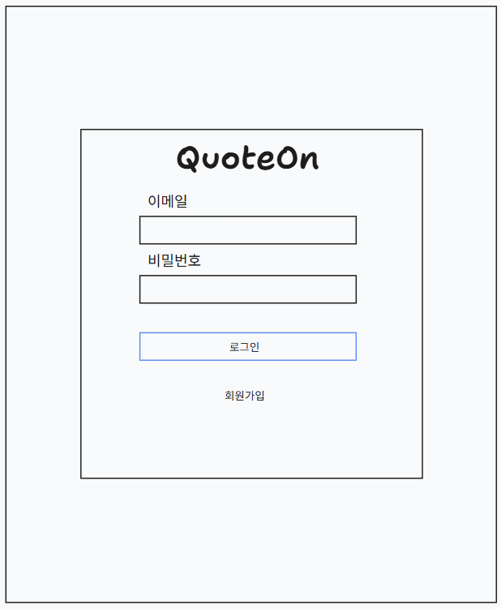

- 출력 데이터 항목 (Output Data):
    - 상단 영역: QuoteOn 서비스 로고
    - 입력 영역: 이메일, 비밀번호
    - 하단 영역: 로그인 버튼, 회원가입 링크

- 입력 데이터 및 검증 규칙 (Input Data & Validation):
    - 이메일: 필수 입력 항목
    - 비밀번호: 필수 입력 항목
    - 이메일 형식 및 입력값 확인

- 화면 제어 및 권한 규칙 (Behavior Rules):
    - 로그인 버튼 클릭 시 입력값을 검증한 후 로그인 처리
    - 로그인 성공 시 회원 상태에 따라 서비스 화면으로 이동
    - 로그인 실패 시 오류 메시지 출력
    - 회원가입 링크 클릭 시 회원가입 화면으로 이동

### 2.2 회원가입 화면 (GET `/signup`)
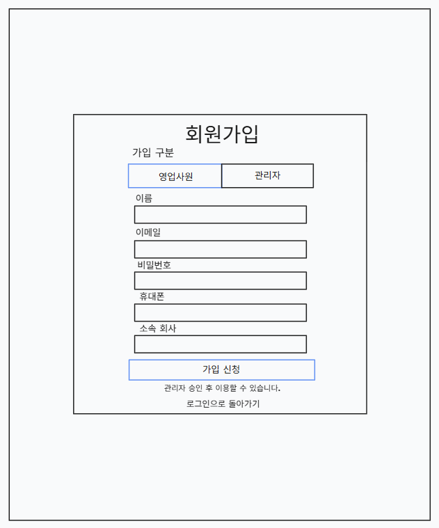

- 출력 데이터 항목 (Output Data):
    - 가입 구분: 영업사원, 관리자
    - 입력 영역: 이름, 이메일, 비밀번호, 비밀번호 확인, 휴대폰, 소속 회사
    - 하단 영역: 가입 신청 버튼, 로그인 화면으로 돌아가기 링크

- 입력 데이터 및 검증 규칙 (Input Data & Validation):
    - 가입 구분: 영업사원 또는 관리자 선택
    - 이름: 필수 입력 항목
    - 이메일: 필수 입력 항목, 이메일 형식 및 중복 여부 확인
    - 비밀번호: 필수 입력 항목
    - 비밀번호 확인: 비밀번호 일치 여부 확인
    - 휴대폰: 연락처 입력
    - 소속 회사: 회사명 입력

- 화면 제어 및 권한 규칙 (Behavior Rules):
    - 가입 신청 버튼 클릭 시 입력값 검증 후 회원가입 신청
    - 가입 신청 완료 후 승인 대기 화면으로 이동
    - 로그인 화면으로 돌아가기 클릭 시 로그인 화면으로 이동

### 2.3 회원가입 승인 대기 화면 (GET `/signup/pending`)
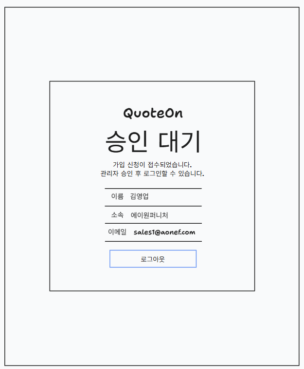

- 출력 데이터 항목 (Output Data):
    - 상단 영역: QuoteOn 서비스 로고
    - 안내 영역: 승인 대기 제목 및 안내 문구
    - 회원 정보: 이름, 소속 회사, 이메일
    - 하단 영역: 로그아웃 버튼

- 화면 제어 및 권한 규칙 (Behavior Rules):
    - 관리자 승인 대기 상태임을 안내
    - 승인 후 로그인하여 서비스를 이용할 수 있음을 안내
    - 신청한 회원의 정보를 표시
    - 로그아웃 버튼 클릭 시 로그아웃 처리

### 2.4 이용 제한 화면 (GET `/access-restricted`)
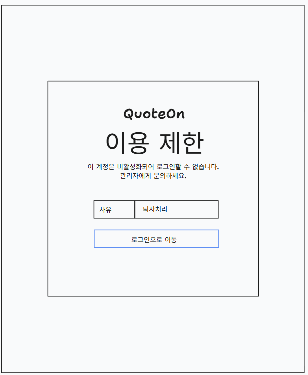

- 출력 데이터 항목 (Output Data):
    - 상단 영역: QuoteOn 서비스 로고
    - 안내 영역: 이용 제한 제목 및 안내 문구
    - 제한 정보: 제한 사유, 회원 상태
    - 하단 영역: 로그인으로 이동 버튼

- 화면 제어 및 권한 규칙 (Behavior Rules):
    - 이용이 제한된 계정의 로그인 및 서비스 이용 제한 안내
    - 제한 사유와 회원 상태 표시
    - 로그인으로 이동 버튼 클릭 시 로그인 화면으로 이동

### 2.5 로그아웃 버튼이 있는 메인 화면 (GET `/consultation`)
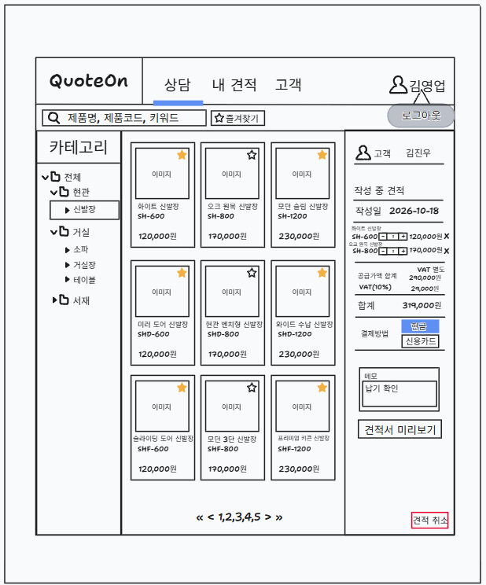

- 출력 데이터 항목 (Output Data):
    - 상단 영역: QuoteOn 로고, 상담·내 견적·고객 메뉴, 로그인 사용자 정보, 로그아웃 버튼
    - 제품 영역: 검색창, 즐겨찾기 필터, 카테고리 목록, 제품 카드
    - 견적 영역: 고객 정보, 작성일, 제품 및 금액 정보, 견적서 미리보기 버튼

- 화면 제어 및 권한 규칙 (Behavior Rules):
    - 로그아웃 버튼 클릭 시 로그아웃 확인 팝업 표시
    - 로그인 사용자 계정에 따라 로그아웃 처리
    - 상담·내 견적·고객 메뉴 클릭 시 해당 화면으로 이동

### 2.6 로그아웃 시 안내 팝업 (GET `/consultation?dialog=logout`)
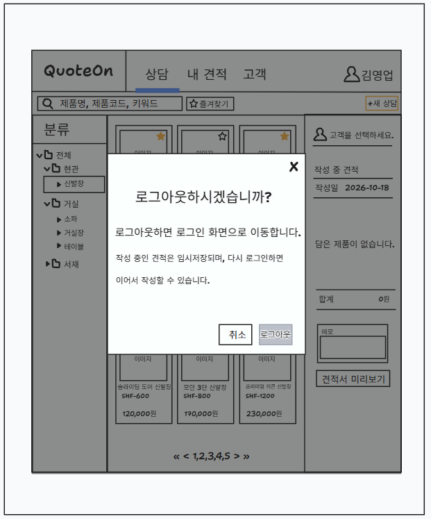

- 출력 데이터 항목 (Output Data):
    - 팝업 제목: 로그아웃하시겠습니까?
    - 안내 문구: 로그아웃 시 로그인 화면으로 이동한다는 안내
    - 버튼: 취소, 로그아웃

- 화면 제어 및 권한 규칙 (Behavior Rules):
    - 취소 버튼 클릭 시 팝업을 닫고 현재 화면 유지
    - 로그아웃 버튼 클릭 시 로그아웃 처리 후 로그인 화면으로 이동

### 2.7 상담 작업대 - 새 상담 시 (GET `/consultation?mode=new`)
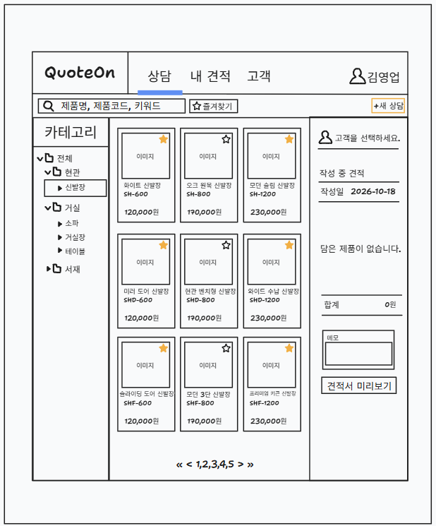

- 출력 데이터 항목 (Output Data):
    - 상단 메뉴: 상담, 내 견적, 고객, 로그인 사용자 정보
    - 제품 검색 영역: 검색창, 즐겨찾기 필터
    - 카테고리 영역: 전체 및 하위 카테고리
    - 제품 목록: 제품 이미지, 제품명, 제품 코드, 가격
    - 견적 영역: 고객 선택, 작성일, 제품 목록, 금액 합계, 견적서 미리보기 버튼

- 화면 제어 및 권한 규칙 (Behavior Rules):
    - 새 상담 시작 시 견적 작성 영역을 초기화
    - 고객 선택 영역 클릭 시 고객 선택 팝업 표시
    - 제품 카드 클릭 시 제품 상세 팝업 표시
    - 제품 선택 후 견적 항목에 추가
    - 견적서 미리보기 버튼 클릭 시 견적서 미리보기 화면으로 이동

### 2.8 상담 작업대 - 고객 선택 팝업 (GET `/consultation/customers`)
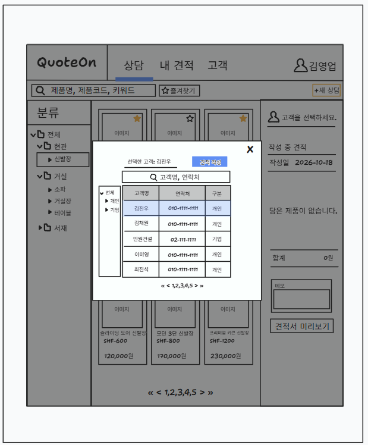

- 출력 데이터 항목 (Output Data):
    - 고객 검색 영역
    - 고객 목록: 고객명, 연락처, 구분
    - 하단 영역: 페이지네이션 및 선택 기능

- 입력 데이터 및 검증 규칙 (Input Data & Validation):
    - 고객 검색어 입력
    - 고객명 또는 연락처를 기준으로 검색

- 화면 제어 및 권한 규칙 (Behavior Rules):
    - 고객 목록에서 고객 선택 시 상담 작업대에 고객 정보 반영
    - 선택한 고객 정보는 견적 작성 영역에 표시
    - 고객 선택 완료 후 상담 작업대로 복귀

### 2.9 상담 작업대 - 견적 진행 중 (GET `/consultation`)
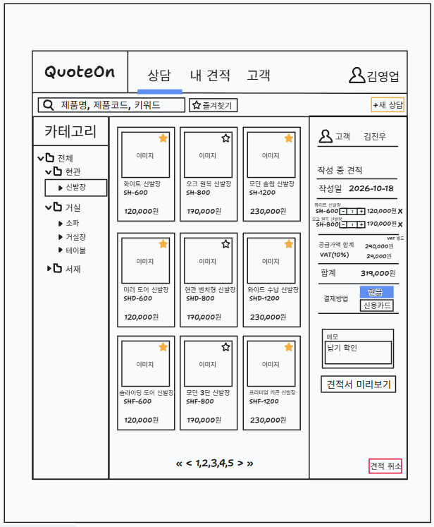

- 출력 데이터 항목 (Output Data):
    - 제품 목록 및 카테고리
    - 선택한 고객 정보
    - 견적 작성일
    - 선택 제품, 제품 코드, 수량, 가격
    - 공급가액, 부가세, 총금액
    - 견적 취소 및 견적서 미리보기 버튼

- 입력 데이터 및 검증 규칙 (Input Data & Validation):
    - 견적에 추가할 제품 선택
    - 제품별 수량 입력 및 변경
    - 수량은 금액 계산이 가능한 유효한 값으로 입력

- 화면 제어 및 권한 규칙 (Behavior Rules):
    - 새 상담에서 제품을 추가하면 견적 항목에 반영
    - 제품을 추가하거나 수량을 변경하면 공급가액, 부가세, 총금액 재계산
    - 부가세는 공급가액의 10%로 계산
    - 고객 정보가 없는 경우 고객을 선택하도록 안내
    - 견적 취소 버튼 클릭 시 견적 취소 확인 팝업 표시
    - 견적서 미리보기 버튼 클릭 시 미리보기 화면으로 이동

### 2.10 제품 상세 팝업 (GET `/products/{productId}`)
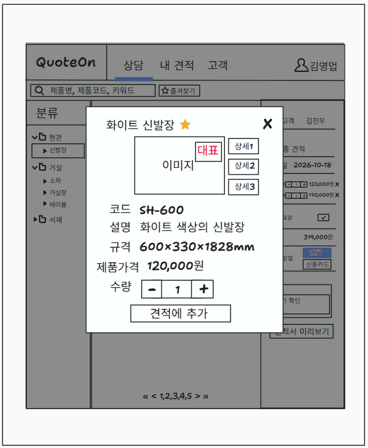

- 출력 데이터 항목 (Output Data):
    - 제품명 및 즐겨찾기 표시
    - 대표 이미지 및 상세 이미지 선택 버튼
    - 제품 코드, 설명, 규격, 판매 가격
    - 수량 선택 영역
    - 견적에 추가 버튼

- 입력 데이터 및 검증 규칙 (Input Data & Validation):
    - 제품 수량 선택
    - 견적에 추가할 수량 확인

- 화면 제어 및 권한 규칙 (Behavior Rules):
    - 제품 이미지와 상세 정보 표시
    - 이미지 선택 버튼 클릭 시 해당 이미지 표시
    - 수량 변경 시 선택 수량 반영
    - 견적에 추가 버튼 클릭 시 선택 제품과 수량을 견적에 반영

### 2.11 제품 상세 - 이미지 확인 팝업 (GET `/products/{productId}/images`)
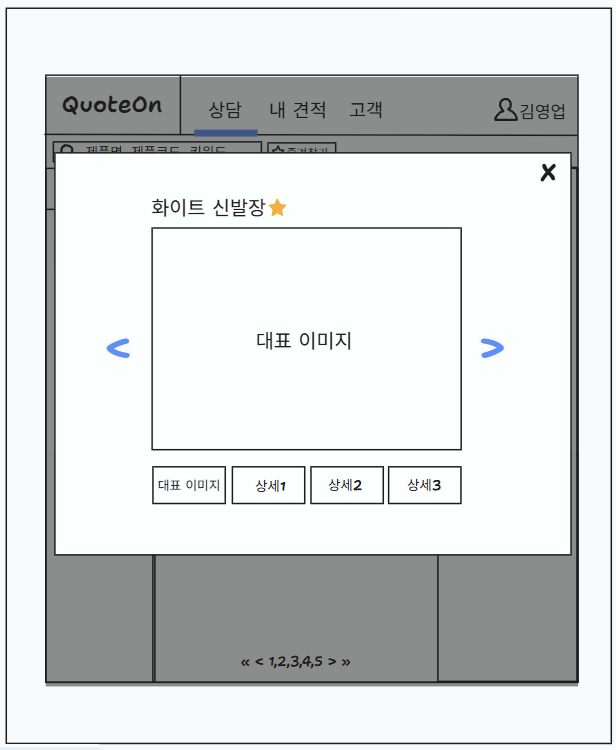

- 출력 데이터 항목 (Output Data):
    - 제품명 및 즐겨찾기 표시
    - 대표 이미지 영역
    - 이전·다음 이미지 이동 버튼
    - 대표 이미지 및 상세 이미지 선택 버튼

- 화면 제어 및 권한 규칙 (Behavior Rules):
    - 대표 이미지 클릭 시 이미지 확인 팝업 표시
    - 이전·다음 버튼 클릭 시 표시 이미지 변경
    - 대표 이미지 또는 상세 이미지 선택 시 해당 이미지 표시
    - 닫기 버튼 클릭 시 제품 상세 팝업 또는 이전 화면으로 복귀

### 2.12 즐겨찾기 화면 (GET `/consultation?filter=favorites`)
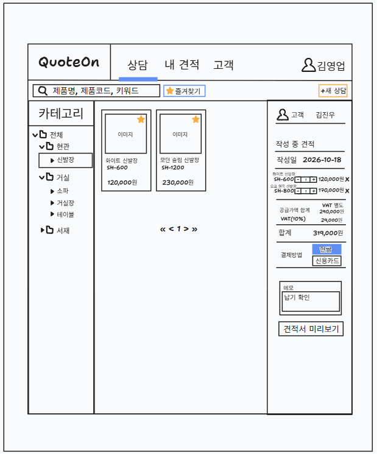

- 출력 데이터 항목 (Output Data):
    - 상단 검색 영역 및 즐겨찾기 필터
    - 제품 목록: 제품 이미지, 제품명, 제품 코드, 가격
    - 견적 작성 영역

- 화면 제어 및 권한 규칙 (Behavior Rules):
    - 즐겨찾기 필터 클릭 시 즐겨찾기에 등록된 제품만 조회
    - 제품 선택 시 제품 상세 정보를 확인할 수 있음
    - 제품을 선택하여 견적에 추가할 수 있음

### 2.13 상담 작업대 - 견적 취소 확인 팝업 (GET `/consultation?dialog=cancel-quote`)
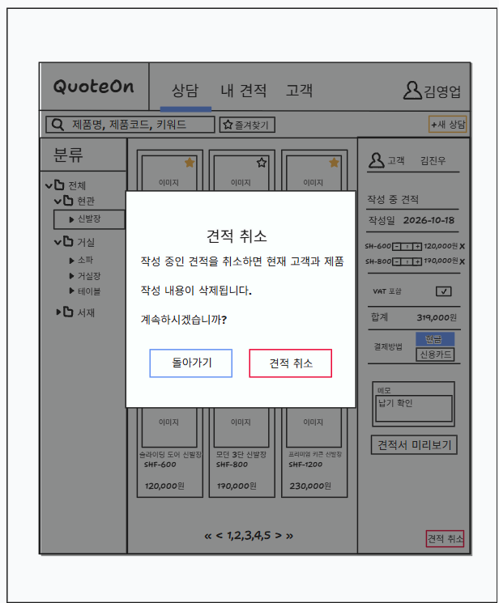

- 출력 데이터 항목 (Output Data):
    - 팝업 제목: 견적 취소
    - 안내 문구: 작성 중인 견적 취소 및 데이터 삭제 안내
    - 버튼: 돌아가기, 견적 취소

- 화면 제어 및 권한 규칙 (Behavior Rules):
    - 돌아가기 버튼 클릭 시 팝업을 닫고 현재 견적 유지
    - 견적 취소 버튼 클릭 시 작성 중인 견적 데이터를 초기화
    - 취소 완료 후 상담 작업대 화면으로 복귀

### 2.14 상담 작업대 - 새 상담 시작 확인 팝업 (GET `/consultation?dialog=new-consultation`)
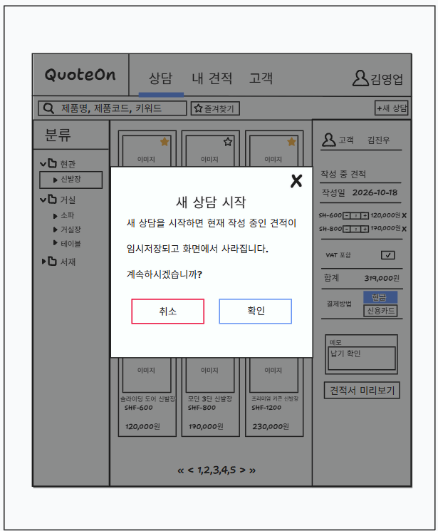

- 출력 데이터 항목 (Output Data):
    - 팝업 제목: 새 상담 시작
    - 안내 문구: 기존 견적 정보가 초기화된다는 안내
    - 버튼: 취소, 확인

- 화면 제어 및 권한 규칙 (Behavior Rules):
    - 취소 버튼 클릭 시 현재 작성 중인 견적 유지
    - 확인 버튼 클릭 시 기존 상담 데이터를 초기화
    - 초기화 완료 후 새 상담 작업대 표시

### 2.15 견적서 미리보기 화면 (GET `/quotes/preview`)
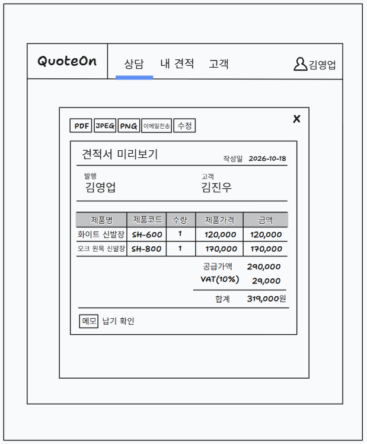

- 출력 데이터 항목 (Output Data):
    - 견적서 미리보기
    - 작성일 및 작성자 정보
    - 고객 정보
    - 견적 항목: 제품명, 제품 코드, 수량, 단가, 금액
    - 공급가액, 부가세, 총금액
    - 파일 형식 선택 영역: PDF, JPEG, PNG 등
    - 수정 및 미리보기 관련 버튼

- 화면 제어 및 권한 규칙 (Behavior Rules):
    - 견적서 내용을 미리 확인할 수 있음
    - 파일 형식 선택 후 해당 형식으로 저장 가능
    - 견적서 수정 버튼 클릭 시 견적 작성 화면으로 복귀
    - 견적서 미리보기 기능을 통해 저장 전 내용을 확인할 수 있음

### 2.16 정식 견적서 화면 (GET `/quotes/{quoteId}`)
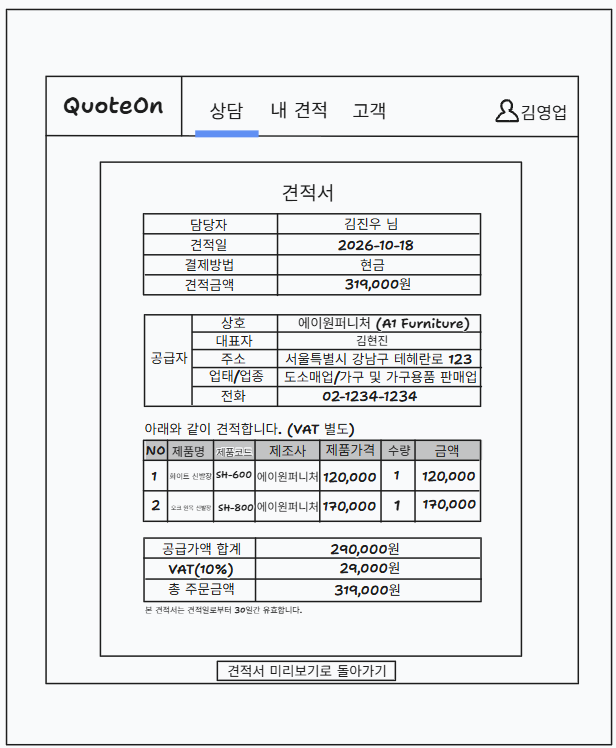

- 출력 데이터 항목 (Output Data):
    - 견적서 제목 및 작성 정보
    - 담당자 및 고객 정보
    - 공급자 정보
    - 견적 항목별 제품 정보, 규격, 수량, 단가, 금액
    - 공급가액, 부가세, 총금액
    - 견적서 미리보기로 돌아가기 버튼

- 화면 제어 및 권한 규칙 (Behavior Rules):
    - 저장된 견적서의 상세 내용을 표시
    - 견적서의 제품 및 금액 정보를 확인할 수 있음
    - 미리보기로 돌아가기 버튼 클릭 시 견적서 미리보기 화면으로 이동

### 2.17 견적서 이메일 전송 화면 (GET `/quotes/{quoteId}/email`)
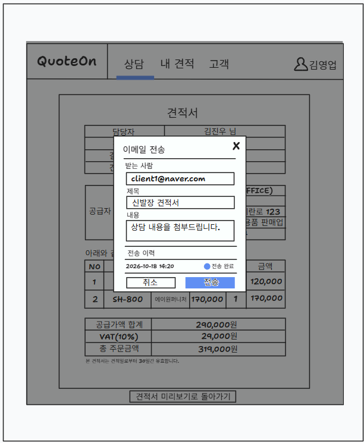

- 출력 데이터 항목 (Output Data):
    - 이메일 전송 팝업
    - 수신자 이메일
    - 이메일 제목
    - 이메일 내용
    - 발송 관련 정보
    - 버튼: 취소, 전송

- 입력 데이터 및 검증 규칙 (Input Data & Validation):
    - 수신자 이메일 입력 및 이메일 형식 확인
    - 이메일 제목 입력
    - 이메일 내용 입력

- 화면 제어 및 권한 규칙 (Behavior Rules):
    - 견적서 이메일 전송 버튼 클릭 시 이메일 전송 팝업 표시
    - 전송 버튼 클릭 시 이메일 발송 처리
    - 견적서 PDF를 이메일에 첨부
    - 발송 결과를 사용자에게 안내
    - 발송 성공 시 견적 상태를 발송 완료로 변경

### 2.18 내 견적 목록 화면 (GET `/quotes/my`)
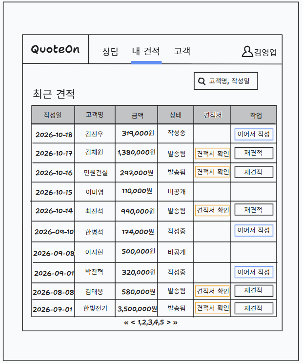

- 출력 데이터 항목 (Output Data):
    - 최근 견적 목록
    - 작성일, 고객명, 금액, 상태
    - 견적서 작성 및 재작성 관련 버튼
    - 검색 영역: 고객명, 작성일
    - 페이지네이션

- 입력 데이터 및 검증 규칙 (Input Data & Validation):
    - 고객명 또는 작성일 기준 검색
    - 검색 조건에 맞는 견적 목록 조회

- 화면 제어 및 권한 규칙 (Behavior Rules):
    - 견적 목록에서 견적을 선택하여 상세 내용을 확인
    - 견적서 작성 버튼 클릭 시 새 견적 작성 화면으로 이동
    - 견적서 확인 버튼 클릭 시 해당 견적서 상세 화면으로 이동
    - 견적 상태에 따라 제공되는 기능을 구분

### 2.19 견적서 확인 화면 (GET `/quotes/{quoteId}/view`)
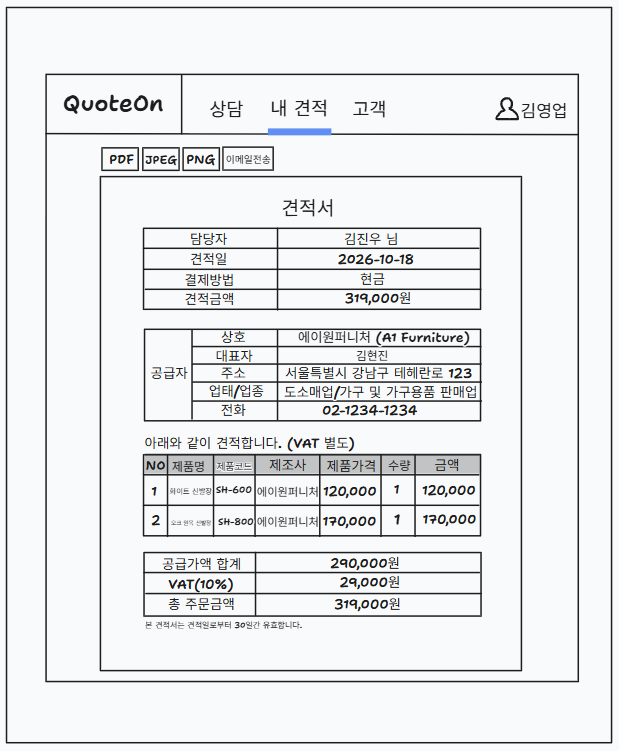

- 출력 데이터 항목 (Output Data):
    - 상단 메뉴: QuoteOn 로고, 상담, 내 견적, 고객, 로그인 사용자 정보
    - 파일 형식 선택 영역: PDF, JPEG, PNG 등
    - 견적서 상세 내용
    - 담당자 및 고객 정보
    - 견적 항목별 제품 정보, 규격, 수량, 단가, 금액
    - 공급가액, 부가세, 총금액

- 화면 제어 및 권한 규칙 (Behavior Rules):
    - 선택한 견적서의 내용을 표시
    - PDF, JPEG, PNG 등 선택한 형식으로 저장할 수 있음
    - 견적서 내용을 확인하고 필요한 경우 파일로 저장
    - 이메일 전송 기능은 견적서 이메일 전송 화면에서 처리

### 2.20 고객 목록 화면 (GET `/customers`)
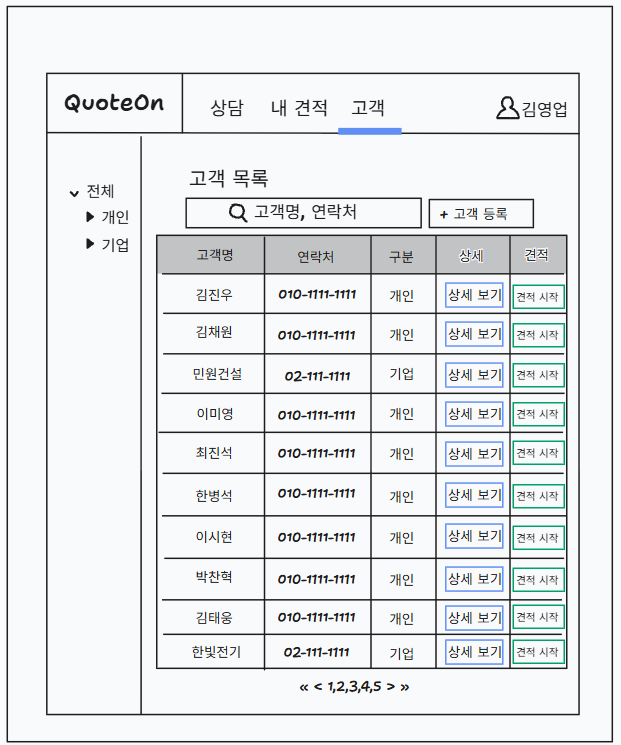

- 출력 데이터 항목 (Output Data):
    - 고객 유형별 분류: 전체, 개인, 기업
    - 고객 검색 영역: 고객명, 연락처
    - 고객 목록: 고객명, 연락처, 구분
    - 기능 버튼: 고객 등록, 상세 보기, 견적서 작성
    - 페이지네이션

- 입력 데이터 및 검증 규칙 (Input Data & Validation):
    - 고객명 또는 연락처 검색어 입력
    - 개인·기업 유형별 목록 조회

- 화면 제어 및 권한 규칙 (Behavior Rules):
    - 고객 유형 선택 시 해당 유형의 고객 목록 조회
    - 고객 등록 버튼 클릭 시 고객 등록 화면으로 이동
    - 상세 보기 버튼 클릭 시 고객 상세 정보 화면으로 이동
    - 견적서 작성 버튼 클릭 시 선택 고객을 기준으로 견적 작성 시작

### 2.21 고객 등록 화면 (GET `/customers/new`)
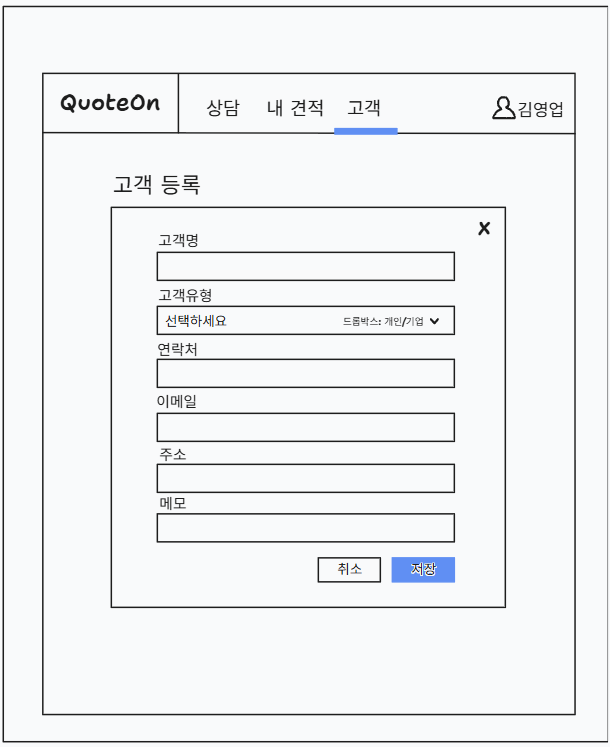

- 출력 데이터 항목 (Output Data):
    - 고객 등록 팝업
    - 입력 영역: 고객명, 고객 유형, 연락처, 이메일, 주소, 메모
    - 하단 영역: 취소, 저장 버튼

- 입력 데이터 및 검증 규칙 (Input Data & Validation):
    - 고객명 입력
    - 고객 유형 선택
    - 연락처 입력
    - 이메일 입력 시 이메일 형식 확인
    - 주소 및 메모 입력

- 화면 제어 및 권한 규칙 (Behavior Rules):
    - 저장 버튼 클릭 시 입력값을 검증한 후 고객 정보 등록
    - 취소 버튼 클릭 시 등록 팝업을 닫고 고객 목록으로 복귀

### 2.22 고객 상세 정보 확인 화면 (GET `/customers/{customerId}`)
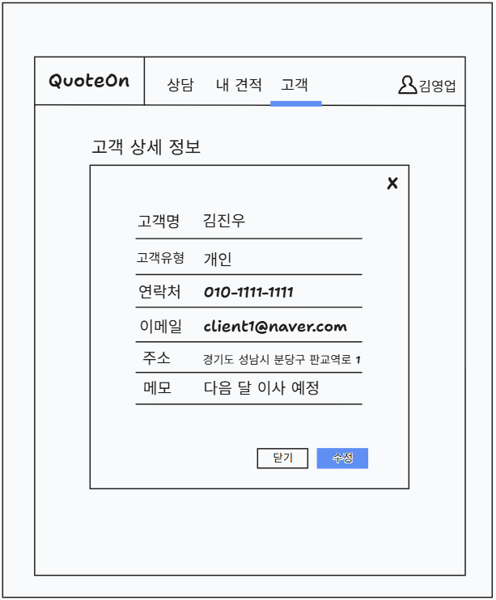

- 출력 데이터 항목 (Output Data):
    - 고객명
    - 고객 유형
    - 연락처
    - 이메일
    - 주소
    - 메모
    - 하단 영역: 닫기, 수정 버튼

- 화면 제어 및 권한 규칙 (Behavior Rules):
    - 선택한 고객의 상세 정보를 표시
    - 닫기 버튼 클릭 시 고객 목록으로 복귀
    - 수정 버튼 클릭 시 고객 상세 정보 수정 화면으로 이동

### 2.23 고객 상세 정보 수정 화면 (GET `/customers/{customerId}/edit`)
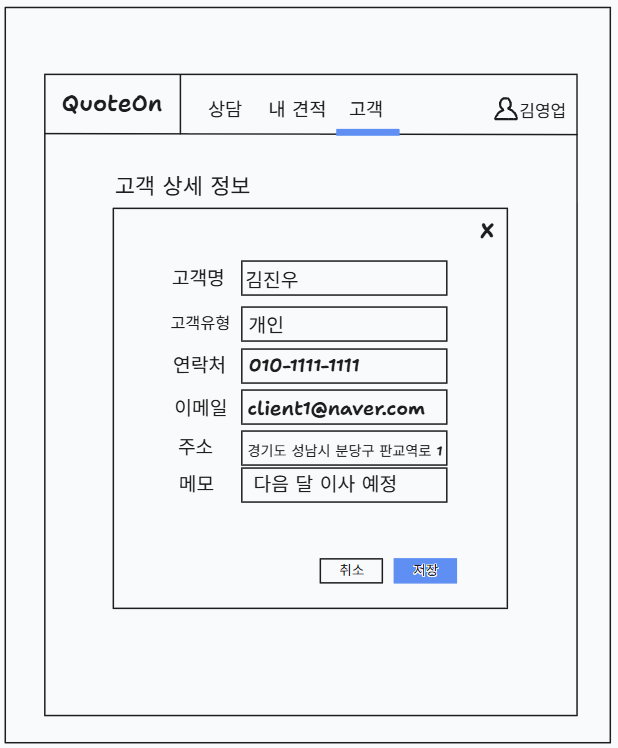

- 출력 데이터 항목 (Output Data):
    - 기존 고객 정보가 입력된 수정 폼
    - 고객명, 고객 유형, 연락처, 이메일, 주소, 메모
    - 하단 영역: 취소, 저장 버튼

- 입력 데이터 및 검증 규칙 (Input Data & Validation):
    - 고객명 수정
    - 고객 유형 수정
    - 연락처, 이메일, 주소, 메모 수정
    - 이메일 입력 시 이메일 형식 확인

- 화면 제어 및 권한 규칙 (Behavior Rules):
    - 기존 고객 정보를 불러와 수정 폼에 표시
    - 저장 버튼 클릭 시 변경된 정보 저장
    - 취소 버튼 클릭 시 변경사항을 저장하지 않고 고객 목록 또는 상세 정보 화면으로 복귀

### 2.24 관리자 통계 대시보드 (GET `/admin/dashboard`)
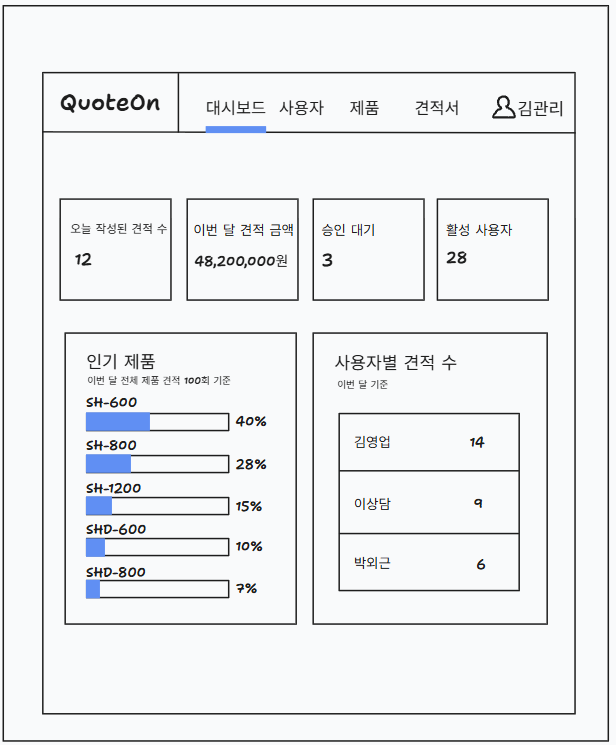

- 출력 데이터 항목 (Output Data):
    - 오늘 작성된 견적 건수
    - 이번 달 견적 금액
    - 승인 대기 회원 수
    - 활성 사용자 수
    - 인기 제품별 견적 비율
    - 사용자별 견적 건수

- 화면 제어 및 권한 규칙 (Behavior Rules):
    - 관리자 전용 통계 화면
    - 주요 통계 데이터를 요약하여 표시
    - 사용자 메뉴 클릭 시 사용자 관리 화면으로 이동
    - 제품 메뉴 클릭 시 제품 관리 화면으로 이동
    - 견적서 메뉴 클릭 시 관리자 견적서 목록으로 이동

### 2.25 관리자 사용자 가입 승인 화면 (GET `/admin/members/pending`)
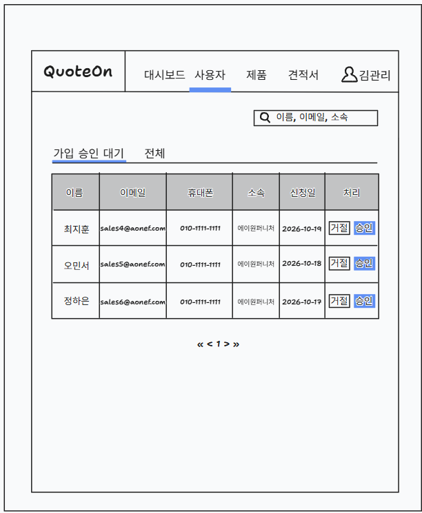

- 출력 데이터 항목 (Output Data):
    - 가입 승인 대기 및 전체 사용자 탭
    - 검색 영역: 이름, 이메일, 소속
    - 사용자 목록: 이름, 이메일, 휴대폰, 소속, 신청일
    - 처리 영역: 거절, 승인 버튼
    - 페이지네이션

- 입력 데이터 및 검증 규칙 (Input Data & Validation):
    - 이름, 이메일 또는 소속 기준 검색
    - 가입 신청 정보 확인

- 화면 제어 및 권한 규칙 (Behavior Rules):
    - 가입 승인 대기 탭에서 승인 대기 회원 조회
    - 승인 버튼 클릭 시 회원 가입 승인 처리
    - 거절 버튼 클릭 시 가입 신청 거절 처리
    - 전체 사용자 탭 클릭 시 전체 사용자 목록으로 이동

### 2.26 관리자 사용자 목록 화면 (GET `/admin/members`)
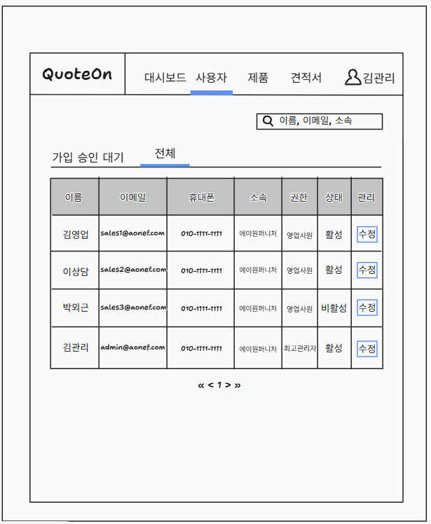

- 출력 데이터 항목 (Output Data):
    - 가입 승인 대기 및 전체 사용자 탭
    - 검색 영역: 이름, 이메일, 소속
    - 사용자 목록: 이름, 이메일, 휴대폰, 소속, 권한, 상태
    - 관리 영역: 수정 버튼
    - 페이지네이션

- 입력 데이터 및 검증 규칙 (Input Data & Validation):
    - 이름, 이메일 또는 소속 기준 검색
    - 사용자 상태 및 권한 정보 조회

- 화면 제어 및 권한 규칙 (Behavior Rules):
    - 전체 사용자 목록 조회
    - 수정 버튼 클릭 시 사용자 정보 수정 화면으로 이동
    - 사용자 상태에 따라 이용 가능 여부를 확인

### 2.27 관리자 사용자 정보 수정 화면 (GET `/admin/members/{memberId}/edit`)
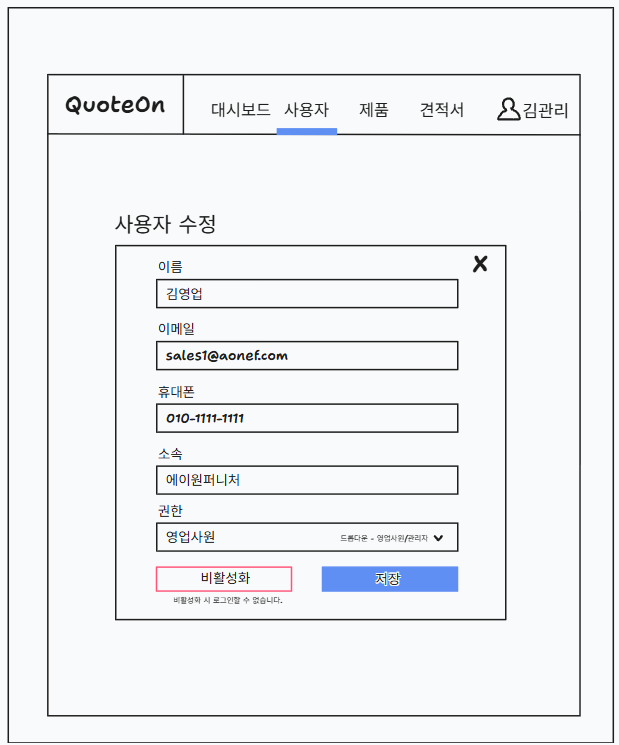

- 출력 데이터 항목 (Output Data):
    - 사용자 수정 폼
    - 이름, 이메일, 휴대폰, 소속, 권한
    - 하단 영역: 비활성화, 저장 버튼

- 입력 데이터 및 검증 규칙 (Input Data & Validation):
    - 이름 수정
    - 이메일 수정
    - 휴대폰 수정
    - 소속 수정
    - 권한 선택
    - 필수 입력 항목 확인

- 화면 제어 및 권한 규칙 (Behavior Rules):
    - 기존 사용자 정보를 불러와 수정 폼에 표시
    - 저장 버튼 클릭 시 변경 정보 저장
    - 비활성화 버튼 클릭 시 사용자 비활성화 처리
    - 비활성화된 사용자는 서비스 이용이 제한됨

### 2.28 관리자 카테고리 관리 화면 (GET `/admin/categories`)
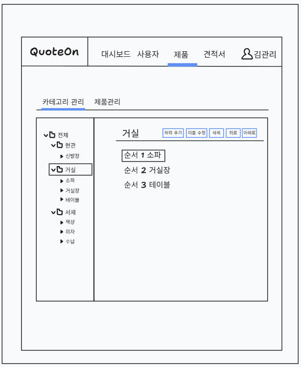

- 출력 데이터 항목 (Output Data):
    - 카테고리 관리 및 제품 관리 탭
    - 카테고리 트리: 전체 및 하위 카테고리
    - 선택한 카테고리의 하위 카테고리 목록
    - 카테고리 추가·수정·삭제 기능

- 입력 데이터 및 검증 규칙 (Input Data & Validation):
    - 카테고리명 입력
    - 상위 카테고리 선택
    - 카테고리명 필수 입력 여부 확인

- 화면 제어 및 권한 규칙 (Behavior Rules):
    - 카테고리 선택 시 해당 카테고리 정보 표시
    - 카테고리 추가 및 수정 기능 제공
    - 삭제 버튼 클릭 시 삭제 확인 절차 진행
    - 제품이 연결된 카테고리 삭제 시 관련 데이터 관계를 확인

### 2.29 관리자 제품 관리 목록 화면 (GET `/admin/products`)
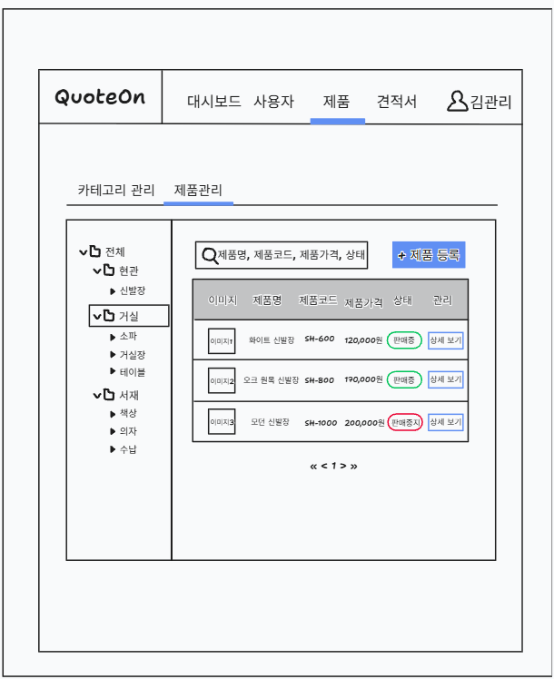

- 출력 데이터 항목 (Output Data):
    - 카테고리 관리 및 제품 관리 탭
    - 카테고리 트리
    - 제품 검색 영역: 제품명, 제품 코드, 세부 정보
    - 제품 목록: 이미지, 제품명, 제품 코드, 판매 가격, 상태
    - 기능 버튼: 제품 등록, 상세 보기, 수정
    - 페이지네이션

- 입력 데이터 및 검증 규칙 (Input Data & Validation):
    - 제품명, 제품 코드 등 검색 조건 입력
    - 검색 조건에 맞는 제품 목록 조회

- 화면 제어 및 권한 규칙 (Behavior Rules):
    - 카테고리 선택 시 해당 카테고리의 제품 조회
    - 제품 등록 버튼 클릭 시 제품 등록 화면으로 이동
    - 상세 보기 버튼 클릭 시 제품 상세 정보 화면으로 이동
    - 수정 버튼 클릭 시 제품 정보 수정 화면으로 이동

### 2.30 관리자 제품 등록 화면 (GET `/admin/products/new`)
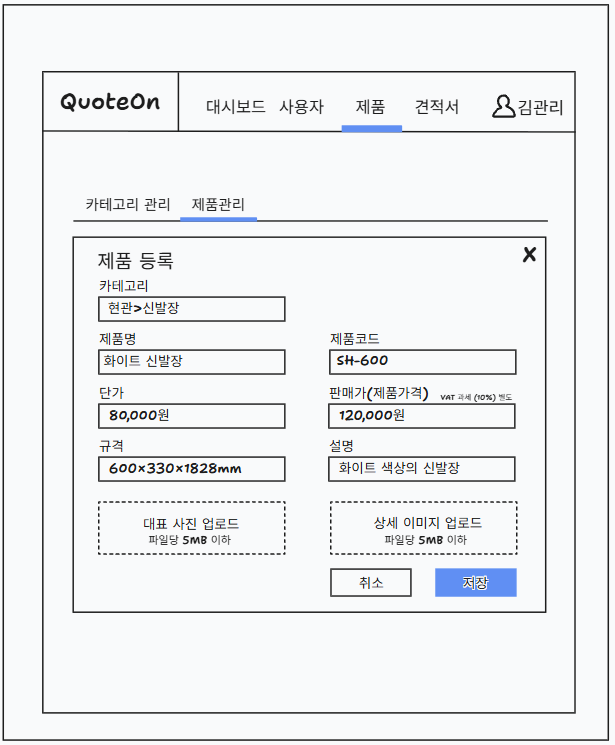

- 출력 데이터 항목 (Output Data):
    - 제품 등록 팝업
    - 입력 영역: 카테고리, 제품명, 제품 코드, 단가, 판매 가격, 규격, 설명
    - 대표 사진 업로드 영역
    - 상세 이미지 업로드 영역
    - 하단 영역: 취소, 저장 버튼

- 입력 데이터 및 검증 규칙 (Input Data & Validation):
    - 카테고리 선택
    - 제품명 입력
    - 제품 코드 입력
    - 단가 및 판매 가격 입력
    - 규격 및 설명 입력
    - 대표 이미지 및 상세 이미지 업로드
    - 필수 항목 입력 여부 및 금액 데이터 유효성 확인

- 화면 제어 및 권한 규칙 (Behavior Rules):
    - 저장 버튼 클릭 시 입력값 검증 후 제품 등록
    - 취소 버튼 클릭 시 등록 팝업을 닫음
    - 등록된 제품은 제품 관리 목록에 표시

### 2.31 관리자 제품 상세 정보 확인 화면 (GET `/admin/products/{productId}`)
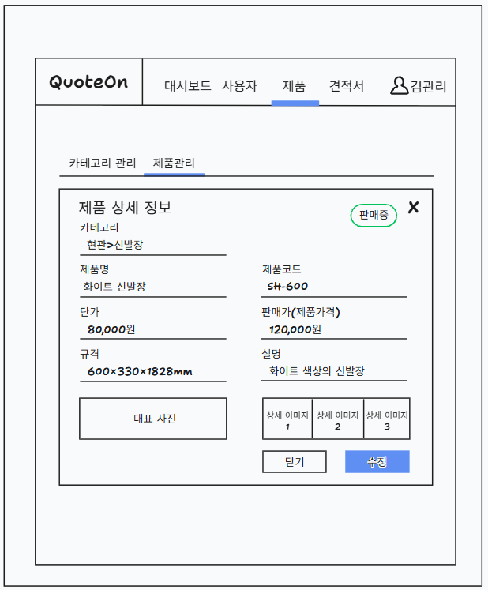

- 출력 데이터 항목 (Output Data):
    - 카테고리
    - 제품명 및 제품 코드
    - 단가 및 판매 가격
    - 규격 및 설명
    - 대표 사진 및 상세 이미지
    - 제품 상태
    - 하단 영역: 닫기, 수정 버튼

- 화면 제어 및 권한 규칙 (Behavior Rules):
    - 선택한 제품의 상세 정보를 표시
    - 대표 사진과 상세 이미지 확인
    - 닫기 버튼 클릭 시 제품 관리 목록으로 복귀
    - 수정 버튼 클릭 시 제품 정보 수정 화면으로 이동

### 2.32 관리자 제품 정보 수정 화면 (GET `/admin/products/{productId}/edit`)
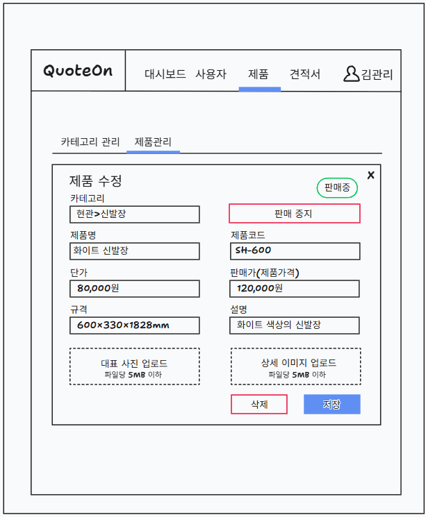

- 출력 데이터 항목 (Output Data):
    - 기존 제품 정보가 입력된 수정 폼
    - 카테고리, 제품명, 제품 코드
    - 단가, 판매 가격, 규격, 설명
    - 대표 이미지 및 상세 이미지 업로드 영역
    - 제품 판매 중지 버튼
    - 하단 영역: 삭제, 저장 버튼

- 입력 데이터 및 검증 규칙 (Input Data & Validation):
    - 카테고리 수정
    - 제품명 및 제품 코드 수정
    - 단가 및 판매 가격 수정
    - 규격 및 설명 수정
    - 대표 이미지 및 상세 이미지 변경
    - 필수 입력 항목 및 금액 데이터 유효성 확인

- 화면 제어 및 권한 규칙 (Behavior Rules):
    - 기존 제품 정보를 불러와 수정 폼에 표시
    - 저장 버튼 클릭 시 변경된 제품 정보 저장
    - 판매 중지 버튼 클릭 시 판매 중지 확인 팝업 표시
    - 삭제 버튼 클릭 시 제품 사용 여부에 따라 삭제 확인 또는 제한 안내 표시

### 2.33 관리자 제품 판매 중지 확인 팝업 - 견적 포함 제품 (GET `/admin/products/{productId}/stop-confirm?usage=used`)

- 출력 데이터 항목 (Output Data):
    - 팝업 제목: 제품 판매 중지
    - 판매 중지 시 기존 견적에 포함된 제품 정보는 유지된다는 안내
    - 버튼: 취소, 판매 중지

- 화면 제어 및 권한 규칙 (Behavior Rules):
    - 취소 버튼 클릭 시 팝업을 닫고 제품 수정 화면 유지
    - 판매 중지 버튼 클릭 시 제품 상태를 판매 중지로 변경
    - 기존 견적 내역의 제품 정보는 유지

### 2.34 관리자 제품 판매 중지 확인 팝업 - 견적 미포함 제품 (GET `/admin/products/{productId}/stop-confirm?usage=unused`)
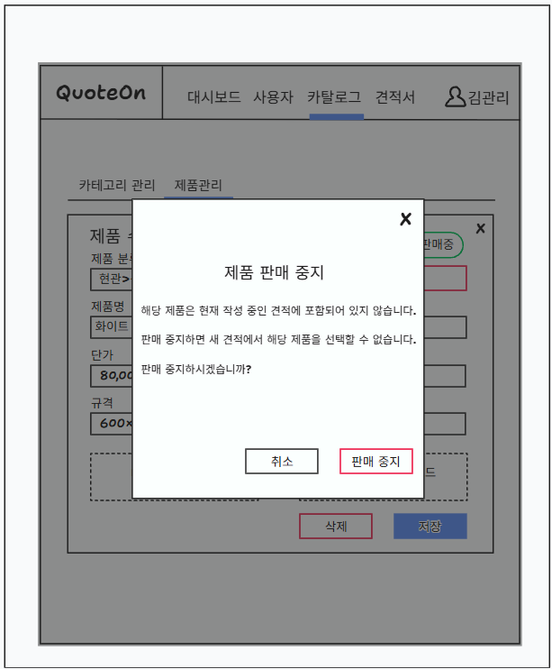

- 출력 데이터 항목 (Output Data):
    - 팝업 제목: 제품 판매 중지
    - 판매 중지 후 신규 견적에서 제품을 선택할 수 없다는 안내
    - 버튼: 취소, 판매 중지

- 화면 제어 및 권한 규칙 (Behavior Rules):
    - 취소 버튼 클릭 시 팝업을 닫고 제품 수정 화면 유지
    - 판매 중지 버튼 클릭 시 제품 상태를 판매 중지로 변경
    - 판매 중지된 제품은 신규 견적에서 선택할 수 없음

### 2.35 관리자 제품 삭제 확인 팝업 - 견적 포함 제품 (GET `/admin/products/{productId}/delete-confirm?usage=used`)
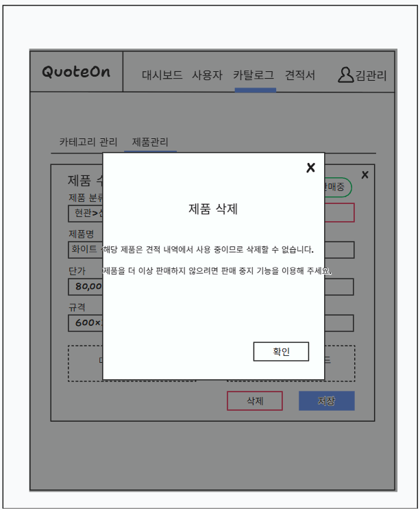

- 출력 데이터 항목 (Output Data):
    - 팝업 제목: 제품 삭제
    - 제품이 기존 견적에 사용 중이므로 삭제할 수 없다는 안내
    - 버튼: 확인

- 화면 제어 및 권한 규칙 (Behavior Rules):
    - 견적에 포함된 제품은 삭제할 수 없음을 안내
    - 확인 버튼 클릭 시 팝업을 닫고 제품 수정 화면으로 복귀
    - 기존 견적 데이터 보존을 위해 제품 삭제를 제한

### 2.36 관리자 제품 삭제 확인 팝업 - 견적 미포함 제품 (GET `/admin/products/{productId}/delete-confirm?usage=unused`)
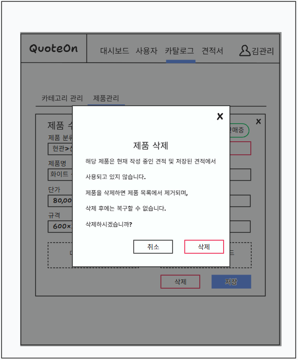

- 출력 데이터 항목 (Output Data):
    - 팝업 제목: 제품 삭제
    - 제품 삭제 시 관련 제품 정보가 제거된다는 안내
    - 삭제 후 복구할 수 없다는 안내
    - 버튼: 취소, 삭제

- 화면 제어 및 권한 규칙 (Behavior Rules):
    - 취소 버튼 클릭 시 팝업을 닫고 제품 수정 화면 유지
    - 삭제 버튼 클릭 시 제품 삭제 처리
    - 삭제 완료 후 제품 관리 목록으로 복귀
    - 삭제된 제품은 제품 목록에서 더 이상 조회되지 않음

### 2.37 관리자 견적서 목록 화면 (GET `/admin/quotes`)
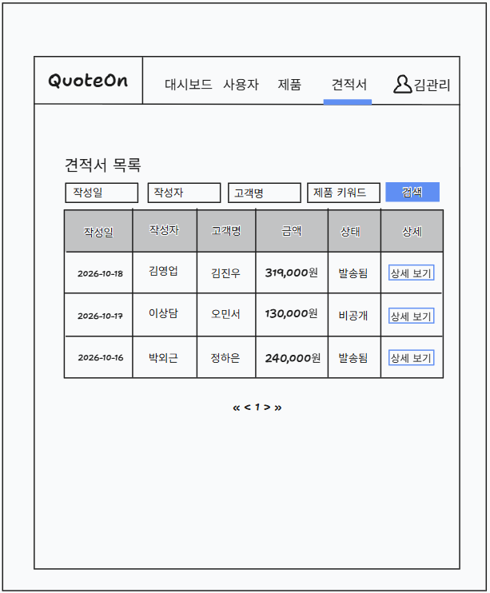

- 출력 데이터 항목 (Output Data):
    - 견적서 목록
    - 검색 조건: 작성일, 작성자, 고객명, 제품 코드
    - 견적 목록: 작성일, 작성자, 고객명, 금액, 상태
    - 상세 보기 버튼
    - 페이지네이션

- 입력 데이터 및 검증 규칙 (Input Data & Validation):
    - 작성일 기준 검색
    - 작성자 기준 검색
    - 고객명 기준 검색
    - 제품 코드 기준 검색

- 화면 제어 및 권한 규칙 (Behavior Rules):
    - 검색 조건에 따라 견적서 목록 조회
    - 상세 보기 버튼 클릭 시 해당 견적서 상세 화면으로 이동
    - 페이지네이션을 통해 목록 이동

### 2.38 관리자 견적서 상세 보기 화면 (GET `/admin/quotes/{quoteId}`)
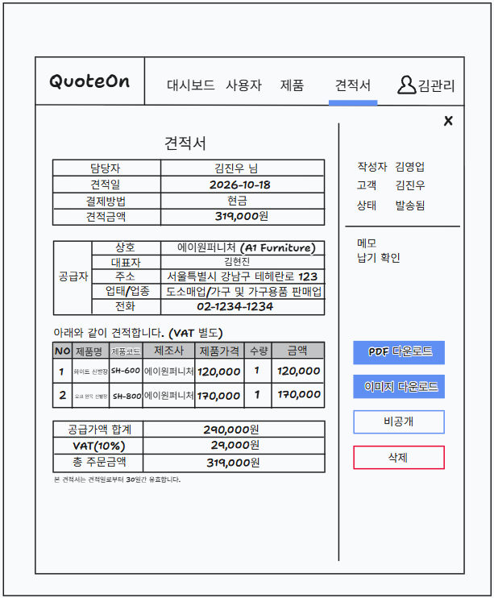

- 출력 데이터 항목 (Output Data):
    - 견적서 작성 정보
    - 담당자 및 고객 정보
    - 공급자 정보
    - 견적 항목별 제품 정보, 규격, 수량, 단가, 금액
    - 공급가액, 부가세, 총금액
    - 견적 상태 및 메모
    - 기능 버튼: PDF 다운로드, 이미지 다운로드, 미리보기, 삭제

- 화면 제어 및 권한 규칙 (Behavior Rules):
    - 선택한 견적서의 상세 내용 표시
    - PDF 다운로드 버튼 클릭 시 PDF 파일 다운로드
    - 이미지 다운로드 버튼 클릭 시 이미지 파일 다운로드
    - 미리보기 버튼 클릭 시 견적서 미리보기
    - 삭제 버튼 클릭 시 견적서 삭제 처리
    - 견적서 삭제 시 관련 견적 항목과 이메일 발송 이력도 함께 삭제
---

## 3. 전체 화면 와이어프레임 배치도
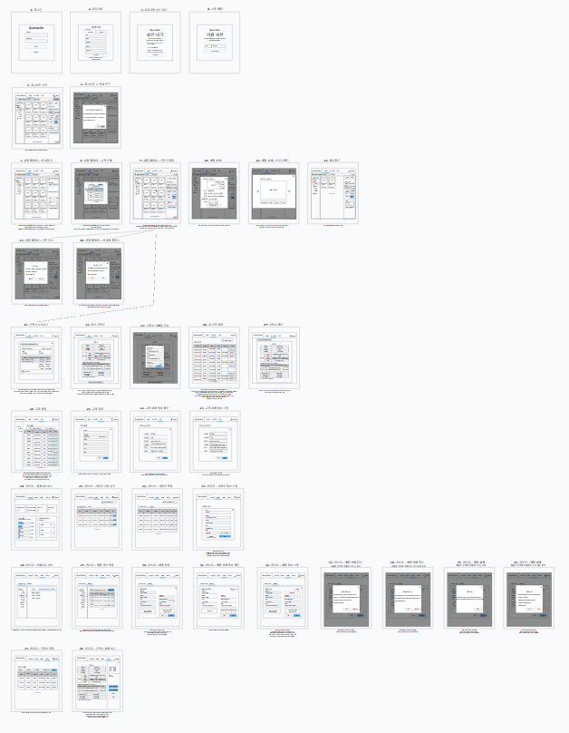

